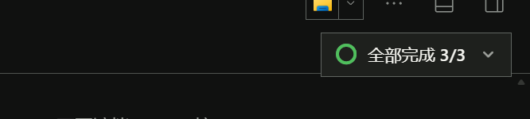
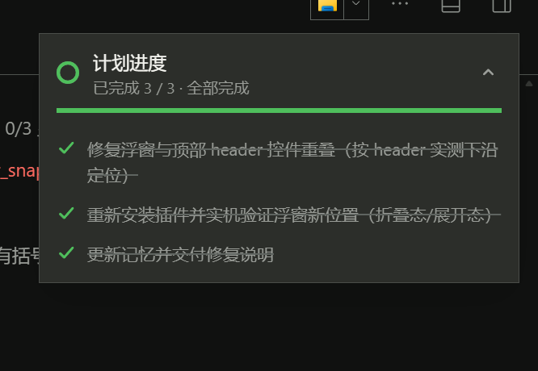

# dsh-plan-progress-pill

DeepSeek Harness Web UI 右上角的**会话计划与进度胶囊浮窗**：从官方 todo 任务清单实时读取当前会话的计划，可收纳成小胶囊、展开成完整任务卡。

A collapsible plan / progress capsule pinned to the top-right overlay of the DSH Web UI. It reads the session's official `todos` projection and shows it as a compact pill or an expanded task card.





## 功能

- **实时计划**：数据源是官方 `todo_write` 写入的 `todos` 会话投影（`turn/start` 时清空、`turn/end` 保留完成清单），agent 每更新一次任务清单，浮窗立即刷新。
- **胶囊 / 卡片两态**：默认收起为胶囊（进度环 + 当前进行中任务摘要 + `已完成 n/m`），点击胶囊或箭头展开完整任务列表；再点收起。收起状态按标签页记忆（sessionStorage）。
- **完整任务视图**：每项带状态图标（✓ 已完成 / 旋转环 进行中 / 虚线圆 待处理）、进度条、完成百分比与「全部完成」状态。
- **不遮控件**：位置在运行时实测会话头部（标签行）下沿后贴齐，不覆盖右上角工具按钮；窗口宽度 ≤720px 时自动落到底部。
- **跟随会话**：随当前会话切换；当前会话没有任务清单时自动隐藏，不占屏幕。
- **主题自适应**：全部颜色使用宿主主题 token（`--dsw-alias-*`），亮/暗主题与桌面端/Web 端一致。

## 安装

```sh
dsh plugin --profile web add dsh-plan-progress-pill
```

桌面版也可以从插件市场安装，或从本仓库源码安装：

```sh
git clone https://github.com/darkzhexue/dsh-plan-progress-pill
dsh plugin --profile web add <本地目录>
```

安装后在会话页右上角出现胶囊；让 agent 使用 `todo_write` 更新任务清单即可看到进度。

## 兼容性

- DSH（DeepSeek Harness）Web 端与桌面版，已验证 `0.2.1-rc.2`。
- 依赖宿主提供的 `slots` / `locale` / `uiSession` 客户端服务与官方 `todo_write` 工具的 `todos` 投影。

## 开发

```
index.js          host 入口（no-op，UI 全部在 client 侧）
client.js         客户端组件：读取 todos 投影、浮窗渲染、定位测量、样式
cordis.patch.yml  bundle 补丁：插入 dsh-plan-progress-pill 行
locale/           中英文案
icon.svg          插件图标
assets/           README 截图
screenshots.json  市场截图声明
```

本地开发与验证：

```sh
npm install                 # 无第三方依赖，仅用于 npm pack 打包检查
npm pack --dry-run
```

插件机制：`package.json` 声明 `dsh.bundle.patch`，`cordis.patch.yml` 向 profile 插入本插件行；客户端 bundle 由 `dsh` 侧的 `dsh.client` 声明加载。修改后需要重装（`remove_bundle` + `install_bundle`）并刷新页面。

## License

MIT © darkzhexue
